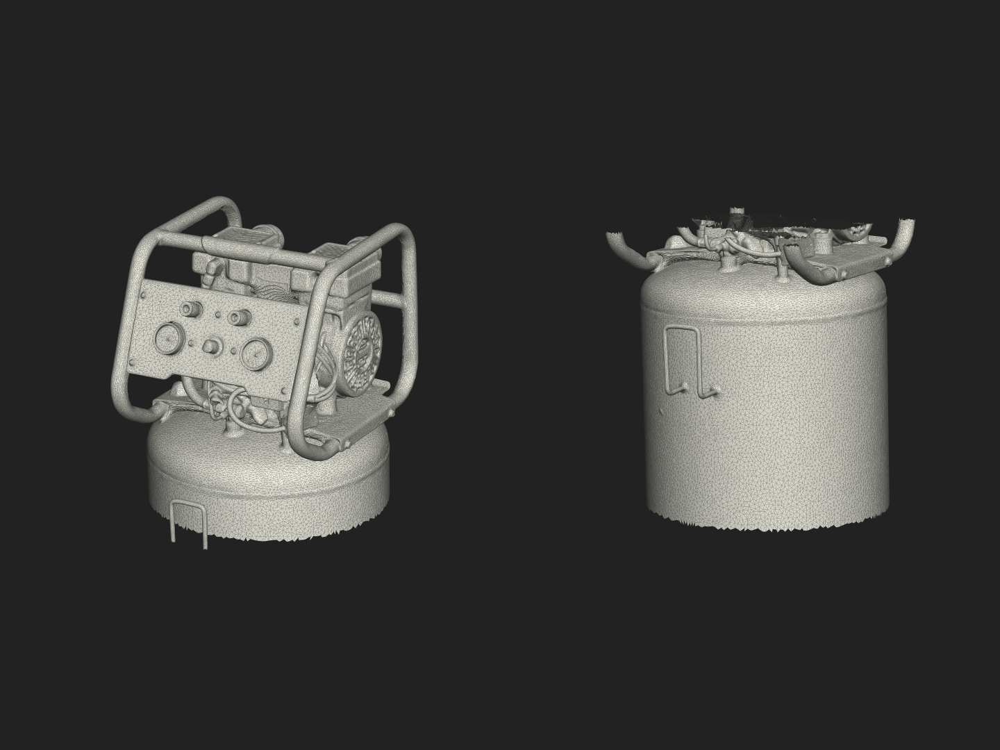
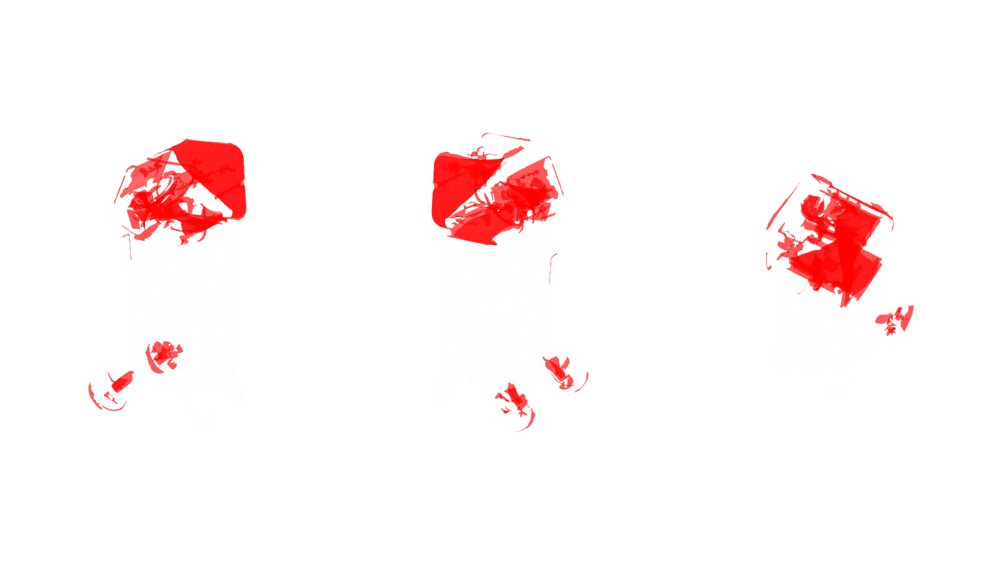
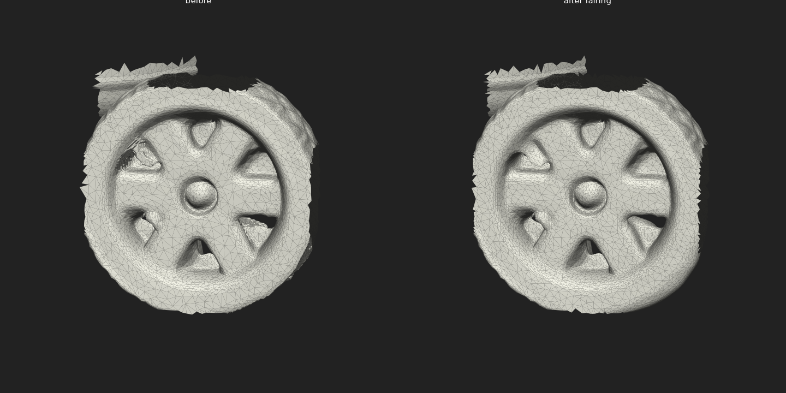

# mesh-solidify

**Turn broken meshes into one watertight, printable solid, with no manual cleanup.**

Scans, game assets and exported models often have holes, open shells,
overlapping parts and self-intersections. Slicers then report *floating object
parts*, *empty layers* or *collapsing overhangs*, or silently drop half the
model. `mesh-solidify` rebuilds the solid from an inside/outside test, so it
doesn't need to understand the holes to close them.



*A 978k-triangle air-compressor model with 29 holes (the largest has a 1.1 m
perimeter at print scale) became one watertight body in about 80 s.*

## Why not just "close holes"?

Hole-filling tools triangulate each boundary loop. That works for small flat
holes. On large 3D holes the patches cut straight through the model: the
result is technically watertight but wrong.



*MeshLab's close-holes on the same model: "watertight", with flat sheets (red)
cutting through the motor and frame. Self-intersections went from 649 to 5,456.*

## How it works

1. **Scale to print size first**, so every tolerance is in real print millimetres.
2. **Generalized winding number** ([Jacobson et al. 2013](https://igl.ethz.ch/projects/winding-number/))
   on a voxel grid. For every point it gives a robust inside/outside answer,
   even with holes and overlapping shells.
3. **Keep the largest connected solid** and drop floating specks.
4. **Narrow-band signed distance**: the sign comes from the winding number and
   the magnitude is the exact distance to the input triangles. Real surfaces
   come out smooth, with no voxel staircase.
5. **Marching cubes** plus manifold repair.
6. **Hole-patch fairing**: vertices far from every input triangle were invented
   to close a hole. They are solved as a biharmonic surface with the real
   geometry held fixed, so patches continue the curvature around them
   instead of terracing.
7. **Quadric decimation** to a triangle budget, then verification
   (watertight, consistent volume, [manifold3d](https://github.com/elalish/manifold) status).



## Install and run

**Single file, no install** (needs [uv](https://docs.astral.sh/uv/)): download
`solidify.py` from the [latest release](https://github.com/JakeMathews/mesh-solidify/releases/latest).
Its header lists its dependencies, so `uv` installs them on the fly:

```bash
uv run solidify.py model.stl fixed.3mf --scale 10%
```

**As a command:**

```bash
pipx install git+https://github.com/JakeMathews/mesh-solidify
mesh-solidify model.stl fixed.3mf --scale 10%
```

**With plain pip:**

```bash
pip install numpy scipy scikit-image trimesh libigl pymeshlab manifold3d lxml rtree
python solidify.py model.stl fixed.3mf --scale 0.1
```

Python 3.10+. Tested on macOS (Apple Silicon); the dependencies all ship wheels for Linux and Windows too.

## Usage

```text
mesh-solidify SRC [DST] [options]

  --scale F         uniform scale applied first: 0.1 or 10%          (default 1)
  --voxel F         grid spacing in output mm (detail vs. RAM/time)   (default 0.125)
  --min-feature F   outward offset in output mm to fatten thin parts  (default 0)
  --iso F           winding-number threshold, 0<iso<1                 (default 0.5)
  --target-faces N  output triangle budget                            (default 400000)
  --fair-tau F      hole-patch distance in voxels; 0 = no fairing     (default 0.5)
  --fair-grow N     extra rings refaired around each patch            (default 2)
  --max-voxels N    refuse larger grids                               (default 4e8)
  --inspect         report the input's defects only (no DST needed)
  --json            one JSON result object on stdout
  -q, --quiet       no progress output
```

The output format comes from the DST extension: `.stl .3mf .obj .ply .off .glb`.

### Tuning

| Symptom | Try |
|---|---|
| Thin tubes or rails vanish in the slicer | `--min-feature 0.2` (offsets the whole surface), or a smaller `--voxel` |
| Out of memory, or exit code 4 | the `--voxel` value suggested in the error message |
| Parts that should be solid come out missing | `--iso 0.3` |
| Fine detail is lost | `--voxel 0.08` (about 2.5× slower) |
| File too big | `--target-faces 200000` |

Rough cost: a grid of about 130M voxels takes ~80 s and ~3 GB of RAM on an M-series Mac.

## For agents and scripts

The CLI is built to be driven by tools and LLM agents:

- **`--json`**: progress goes to stderr; stdout gets exactly one JSON object
  with `ok`, `watertight`, `bodies`, `size_mm`, `triangles`, `faired_vertices`
  and the parameters used.
- **`--inspect --json`**: a cheap check before committing to a full run
  (holes, hole perimeters, components, size at the given scale).
- **Exit codes**: `0` ok, `1` error, `2` bad arguments, `3` output failed
  verification, `4` grid too large (the message includes a working `--voxel`).
- **Validated arguments**: non-numeric, zero, negative, NaN and out-of-range
  values are rejected with a readable message before any work starts.
- **Agent skill**: [`skills/mesh-solidify/SKILL.md`](skills/mesh-solidify/SKILL.md)
  is a ready-made Claude Code skill. Drop the folder into `.claude/skills/`.

```console
$ mesh-solidify broken.stl --inspect --scale 10% --json -q
{ "ok": true, "watertight": false, "components": 3, "holes": 29,
  "largest_hole_perimeters_mm": [1105.0, 150.39, ...], "size_mm": [45.2, 50.6, 104.1], ... }
```

Or from Python:

```python
from solidify import solidify
res = solidify("broken.stl", "fixed.3mf", scale=0.1)
assert res["ok"]
```

## Limitations

- **The output is solid.** Hollow interiors (an empty tank, a cup) come out filled.
- **Only the largest connected solid is kept.** Loose separate parts are dropped;
  the JSON reports how many voxels were dropped.
- **Features thinner than about one voxel can disappear.** Lower `--voxel` or use `--min-feature`.
- **Sharp edges are slightly rounded** at the voxel scale.

## License

[MIT](LICENSE). The dependencies keep their own licenses. Note that
[PyMeshLab](https://github.com/cnr-isti-vclab/PyMeshLab) is GPL-3.0; it's
installed separately and isn't bundled here.
